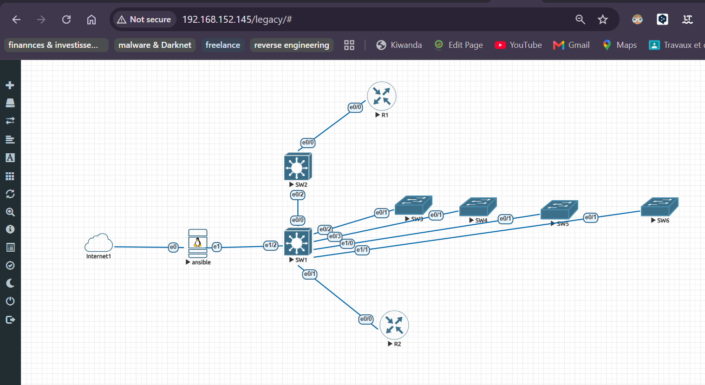

# AUTOMATISATION AVEC ANSIBLE


**Objectif :** Ce projet a pour but d'automatiser les configurations sur des équipements en utilisant l'outil Ansible. 


## I- PREREQUIS
Afin de reproductuire ce travail, il est important que vous ayez les éléments suivants sur votre os (Ubuntu Desktop/dans mon cas):
- Eveng : ici nous allons ajouter des nodes pour la machine ubuntu (sur laquelle nous allons installer ansible et ansible-pylibssh), pour nos switchs (tous étant du même modèle) et pour nos routeurs (tous étant aussi du même modèle). 
- Cloner ce dépot sur notre machine ubuntu. 
- Installer scp sur notre serveur ansible (pip install scp)
- Installer les outils de ansible nécessaire à la communication avec windows (pip3 install pyopenssl, pip install requests, pip install pywinrm). En ajoutant l'option --break-system-packages  pour eviter de tomber sous le coup de création d'un environnement virtuel. 

**NB :** Dans un contexte réel, nous aurons juste de besoin d'une machine sur laquelle ansible est installé et des équipements physique au lieu d'utiliser *Eveng*.

## II- ANSIBLE POUR LE RESEAU

<p align="left">
  
</p>


### A. Préparation 
#### a) Préparation du serveur ansible
Nous allons procéder à deux configuration
1. Configuration de la résolution de noms : Afin d'éviter durant les tests de devoir retenir l'ensemble de nos IPs. Nous allons modifier le fichier de hosts de notre machine ubuntu. Cela revient à :
```shell

nano /etc/hosts # A l'intérieur nous rajoutons le contenu de ./demo-ansible/Automatisation_Ansible_switch&routeur/hosts_système 

```
2. Configuration du fichier inventaire de ansible : l'objectif ici des de finir des groupes qui dépendamment de ce que nous aurons envie de faire, nous allons choissir le groupe approprié. Il nous suffira donc de : 
```shell
# Nous nous déplaçons dans le repertoire ansible 
cd /etc/ansible/
# Nous faissons une copie du fichier host
cp hosts hosts.old
# Nous supprimons la première version de host
rm hosts
# Nous copions le contenu de ./demo-ansible/Automatisation_Ansible_switch&routeur/hosts_ansible et nous créons un nouveau fichier hosts avec ce dernier.
nano hosts # puis à l'intérieur nous collons le contenu précédemment copié.
```

#### b) Préparation des équipements réseau
Cette étape fait référence à la configuration de base à effectuer sur nos équipements réseau. Elle est importante car elle permettra à ansible par la suite de pouvoir se connecter à nos équipements par ssh. Il s'agit notamment de :
1. Configurer les interfaces : Nous allons configurer l'interface vlan 1 sur l'ensemble de nos switchs et une interface sur l'ensemble de nos routeurs. Nous devrions veuillez à ce que les adresses IP de ces interfaces soit dans le même réseau que notre serveur qui héberge **ansible**
2. Configurer le ssh et l'utilisateur qui s'y connectera : nous allons donc configurer l'utilisateur et le protocole ssh, la version du protocole ssh ;
3. Configurer l'accès en mode privilégié via le mot de passe ;
4. Configurer le chiffrement des mots de passe : nous allons configurer l'accès au mode enable en utilisant un mot de passe;
5. configurer l'interface VTY.

L'exmeple suivant présente ces configurations pour l'interface vlan 1 du SWICH 1. Il impotant de s'assurer que si l'ip du serveur ansible est par exemple (ip 192.168.80.1/24), alors les ip des autres équipements devront être dans la même plage avec le même masque. 

Pour nos équipements reseau, nous allons choisir la plage 192.168.80.10-192.168.80.17/24. Ainis dans notre cas nous avons 6 switchs et 02 routeurs. Donc l'ip des interfaces **vlan 1** de nos switchs iront de **192.168.80.10-192.168.80.15/24** et les 02 interfaces (**Ethernet0/0**) de nos routeurs iront de **192.168.80.16-192.168.80.17/24**. Ci-dessous nous avons une configuration initaile sur un de nos switchs, nous allons faire la même chose sur les autres équipements.
```yaml
# -+ Configuration de l'IP de l'interface vlan 1 ou juste une interface Ethernet0/1:
  Switch> en 
  Switch# configure terminal
  Switch(config)# interface vlan 1
  Switch(config-if)# ip address 192.168.80.10 255.255.255.0
  Switch(config-if)# no shutdown
  Switch(config-if)# exit 
# -+ Configuration du domaine : 
  Switch(config)# ip domain name manageme.org
# -+ Configuration du SSH : 
  Switch(config)# crypto key generate rsa general-keys modulus 2048
  Switch(config)# ip ssh version 2
# -+ Configuration des ligne vty :
  Switch(config)# line vty 0 4
  Switch(config-line)# transport input ssh 
  Switch(config-line)# login local
  Switch(config-line)# exit
# -+ Création de l'utilisateur qui devra se connecter en SSH avec les maximum de privilèges :
  Switch(config)# username cisco privilege 15 password cisco 
# -+ Activation du chiffrement du mot de passe :
  Switch(config)# service password-encryption
# -+ Configuration du mot de passe pour le mode privilégié :
  Switch(config)# enable secret cisco
  Switch(config)# end
```
Une fois la configuration terminée sur l'ensemble de nos équipements, nous allons exécuter le ping depuis l'un de ces équipements vers l'ensemble des autres pour s'assurer que tout est *okey*.

**NB :** Les informations de connexions seront les mêmes sur tous nos équipements (mot de passe enable, username/password pour la connexion SSH).

### B. Exécution des playbooks
La configuration primordiale étant exécutée, nous allons passer à quelque chose d'un peu plus costaud. 
```shell
# Test de ping avec ansible sur l'ensemble de équipements réseau
ansible all -m ping -u cisco -k

# En étant dans le repertoire ./Automatisation_Ansible_switch&routeur , nous allons exécuter la commande suivante 
ansible-playbook playbook_cfg-base.yml -u cisco -k   
# Elle nous invitera par la suite à saisir le mot de passe **cisco** dans notre cas.

# Nous pouvons aussi utiliser la commande
ansible-playbook -i /etc/ansible/host.ini(ou yml) playbook_cfg-base.yml -u cisco -k  

# ou /etc/ansible/host.ini(ou yml) est le chemin vers notre fichier d'inventaire, il n'est pas obligé d'être le fichier host par défaut. 


# Pour la configuration des vlans
ansible-playbook playbook_vlans-ports-security.yml -u cisco -k

# Pour la configuration du snmp 
ansible-playbook playbook_snmp.yml -u cisco -k

# Pour  la réalisation du backup, nous allons exécuter le code ci-dessous. Nous allons voir un dossier appelé backup avec l'ensemble des fichiers backup de nos équipements. 
ansible-playbook playbook_backup-config.yml -u cisco -k 

# Restauration du backup
ansible-playbook playbook_restore-backup.yml -u cisco -k  

# Pour voir le fichier copié sur l'équipement, nous allons nous connecter à l'équipement et ensuite exécuter la commande suivante, depuis le mode enable.  

# Installation d'un nouvel os vers l'équipemet. On devra toujours se rassurer que nous avons de l'espace libre sur notre équipement

# on peut le vérifier avec en étant en mode enable
dir flash:

# Si nous avons suffisamment d'espace, nous pouvons lancer la commande suivante : 
ansible-playbook playbook_restore-backup.yml -u cisco -k 
dir
```

**NB :** Afin d'éviter la modification des fingerprint, nous pouvons configurer ansible pour que cette réinitialisation ne se fasse pas de la manière suivante. Mais dans mon cas, je ne l'ai pas configuré. 
```shell
nano /etc/ansible/ansible.cfg 

# A l"intérieur du fichier ansible.cfg, nous allons copier les deux lignes ci-dessous

[defaults]
host_key_checking = False

# Si nous voulons qu'il nous demande ou pas le mot de passe pour le mode priviligié, nous pouvons ajouter aussi les lignes ci-dessous. 

[privilege_escalation]
become_ask_pass=true

# Si nous voulons définir un temps d'attente souvent nécessaire lorsque que nous faisons un transfert de fichiers d'un os vers un équipement réseau.
[persistant_connection]
command_timeout = 600
```


## III- ANSIBLE POUR LES SERVEURS
### A. Ansible pour Windows  
Avant de pour exécuter des playbook depuis notre serveur ansible pour notre serveur windows, il est important de configurer un certain nombre de chose pour que tout puisse bien se passer. Cette configuration doit être faite à la fois sur nos serveur windows (Windows Server 2012, 2016, 2019, etc) et nos clients windows (Windows 10, 11, etc) Dans notre cas, nous avons utiliser **winrm** afin que notre serveur ansible puisse communiquer avec notre windows server 2019. Il vous suffit de vous rendre sur la documentation officiel d'ansible et vous trouverez le nécessaire pour effectuer ces configurations. Nous avons utilisé le script (N°5) et avons procédé de la manière suivante :
- Copie du script sur ma vm windows server, par exemple dans le dossier download ; 
- Puis nous avons exécuté les commandes suivantes dans le powershell (ouvert en mode Administrateur) :
```shell
# Fixation du chemin vers le script
ansible windows-server -i hostAD.ini -m win_ping
$file = "C:\Users\Administrator\Downloads\ConfigureRemotingForAnsible.ps1"

# Exécution du script 
powershell.exe -ExecutionPolicy Bypass -File $file -Verbose
```


> **NB :**
Une fois que nous avons terminé avec la configuration, nous pouvons donc tester nos playbook. Nous devrons être dans le repertoire  **Automatisation Ansible Windows Serveur** avant d'éxécuter les commandes ci dessous. Dans le cas contraire, il faudra utiliser le chemin absolue pour pour le fichier **hostAD** et pour l'ensemble des **playbook**. 

Nous pouvons donc à présent configurer ma machine windows serveur, en exécutant au choix les commandes suivantes : 
```shell
# Test du ping sur notre serveur Active Directory
ansible windows-server -i hostAD -m win_ping

# Vérification de la syntaxe de notre playbook de création d'un controleur de domaine 
ansible-playbook --syntax-check -i hostAD playbook_creation-DC.yml

# Création de notre controlleur de domaine et du nécessaire
ansible-playbook -i hostAD playbook_creation-DC.yml

# Ajouter des clients au domaine
ansible-playbook -i hostAD playbook_add-clientfordomain.yml
```


## IV- REFERENCES 
1. Module ansible pour ios_cisco : https://docs.ansible.com/projects/ansible/latest/collections/cisco/ios/index.html#plugins-in-cisco-ios
2. Mots Clés Ansible : https://docs.ansible.com/projects/ansible/latest/reference_appendices/playbooks_keywords.html
3. Modules Ansible pour système Linux : https://docs.ansible.com/projects/ansible/latest/collections/ansible/builtin/index.html#plugins-in-ansible-builtin 
4. Ansible & Windows : https://docs.ansible.com/projects/ansible/latest/os_guide/windows_usage.html, https://docs.ansible.com/projects/ansible/latest/os_guide/windows_winrm.html#windows-winrm 
5. Script de la communauté ansible pour la configuration de winrm : https://github.com/ansible/ansible/blob/stable-2.9/examples/scripts/ConfigureRemotingForAnsible.ps1,  https://github.com/faezehghiasi/ansible-windows-playbooks 
6. Modules Ansible pour système Windows : https://docs.ansible.com/projects/ansible/latest/collections/ansible/windows/index.html